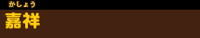
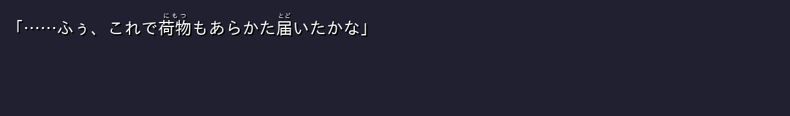
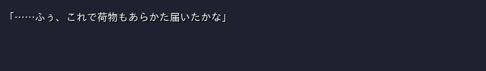

# Release validation — v0.3.0

The maintainer confirmed that v0.3.0 works in their game installation and requested this public release. These focused checks complement that confirmation; they do not claim a complete playthrough or coverage of every game build, system, or mod combination.

The released `patch3.xp3` is unchanged from the tested package:

```text
SHA-256: 29f9e668adb0ec18b3d78830f8b0f39af31025693ff70f41763d84534c4065ab
Size:    210278 bytes
```

Nine Python tests cover annotation preservation, okurigana and compounds, existing ruby and controls, XP3 round-tripping and corruption, hashes matching the original archive, encrypted bytes matching an original entry, the expected script set, and speaker-name readings and bounds.

An independent `awaken1ng/krkr-xp3` reader opened all seven generated entries in `neko_vol1_steam` mode. Every decoded entry passed its Adler-32 check. See [validation/independent-reader-v0.3.0.json](validation/independent-reader-v0.3.0.json).

The isolated fixture used KiriKiri Z 1.4.0.8 and the game's native `textrender.dll` with a minimal message host. It checked:

- Compilation of all seven scripts and successful initialization status.
- Identical native-parser base text for all 4,102 annotated strings.
- F7, held-key suppression, mouse input, and preference updates.
- Preserved typewriter position, timer identity, start time, and wait signals.
- All 16 name images, repeated toggles, nine anchors, hide/show, empty speakers, and language changes.
- Name-layer storage, restoration, and image assignment.
- Backlog name readings without changes to the original name bitmap.

The dialogue sample changed 299 ruby pixels and zero base-text pixels. Cropping the added name band produced a pixel-identical original name bitmap. The backlog name bitmap was also unchanged below its ruby band. See [validation/renderer-checks.json](validation/renderer-checks.json) and [validation/unit-tests-v0.3.0.txt](validation/unit-tests-v0.3.0.txt).

These images are native-renderer fixture exports, not screenshots of the game running through Steam.

| Name readings on | Name readings off |
| --- | --- |
|  |  |





